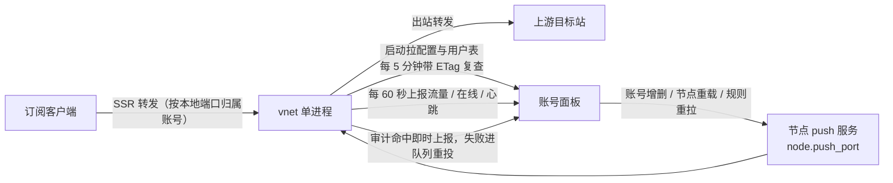

# VNet-SSR

SSR 协议节点后端，Go 单进程，对接任何实现这套 WebAPI 的账号面板。它不发放账号也不计费：启动时按 `node_id` 与 `key` 向面板拉本节点的监听配置和用户表，按端口起转发，再周期性回传流量、在线、心跳与审计命中；面板反向推送账号变更、节点重载与规则重拉。面板不可达时，进程在拉配置那一步就退出。

接口契约由本仓定义：字段级在 [docs/openapi.yaml](docs/openapi.yaml)，算法名单在 [docs/capabilities.json](docs/capabilities.json)。任何按这套契约实现的面板都能直接对接；面板侧的一份公开实现是 [ProxyPanel](https://github.com/ProxyPanel/ProxyPanel)。

本仓在 GPL-3.0 下发布（全文见 [`LICENSE`](LICENSE)）。算法、转发收口、会话身份与接口契约都是重写过的，变更史在 git log 与 [GitHub Releases](https://github.com/ProxyPanel/VNet-SSR/releases)。

## 拓扑



三条同步通道各自做什么、多久跑一次，写在 [docs/integration.md](docs/integration.md)。

## 部署

装机脚本只认管道末尾这几个变量：`WEB_API` 面板基址、`NODE_ID` 节点 id、`NODE_KEY` 节点授权 key，三个都给才会改写 `/etc/vnet/config.json`；`WITH_TUNE=1` 顺带做系统调优。凭据由面板生成，面板后台给出的部署命令里这几个变量已经填好，自己拼时按这个形状：

```bash
curl -L -s https://raw.githubusercontent.com/ProxyPanel/VNet-SSR/master/release/deploy.sh \
| WEB_API="https://panel.example.com" NODE_ID=7 NODE_KEY=<节点密钥> WITH_TUNE=1 bash
```

装完落地三样东西：

| 位置 | 内容 |
| --- | --- |
| `/usr/bin/vnet/vnet` | 二进制，另在 `/usr/local/bin/vnet` 建软链 |
| `/etc/vnet/config.json` | 配置，见下一节 |
| `vnet` 服务单元 | systemd 与 sysv 自动择一，用 `systemctl status vnet` 看 |

`WITH_TUNE=1` 让装机顺带跑 [release/tune.sh](release/tune.sh)：只写 `/etc/sysctl.d`、`/etc/modules-load.d`、`/etc/modprobe.d` 和 vnet 的 systemd drop-in 四处，不动 sshd、不动防火墙，`--rollback` 一键删掉这些改动。`WITH_DNS_CACHE=1` 装 dnsmasq 本机解析缓存，默认不开，判据与回退见 [docs/operations.md](docs/operations.md#本机-dns-缓存)。

其余开关看 `bash release/deploy.sh -h`。

## 配置

`/etc/vnet/config.json` 只有四个键，改完 `systemctl restart vnet`：

| 键 | 含义 |
| --- | --- |
| `api_host` | 面板给节点用的基址，不带路径，且必须以 `http://` 或 `https://` 开头，例 `https://panel.example.com` |
| `node_id` | 面板上的节点 id，填 0 视为未填 |
| `key` | 面板发的节点授权 key |
| `host` | 监听地址，默认 `0.0.0.0`，即仅 IPv4 通配。双栈怎么开见 [docs/operations.md](docs/operations.md#监听地址与多-ip--双栈) |

四个键也能用同名命令行标志传给 `vnet`，`--config` 默认读当前目录的 `config.json`。

`push_port` 与 `secret` 由面板下发，不写在这个文件里；`secret` 为空时节点拒绝启动 push 服务，判据见 [docs/integration.md](docs/integration.md#寻址与鉴权)。

## 升级

```bash
curl -L -s https://raw.githubusercontent.com/ProxyPanel/VNet-SSR/master/release/upgrade.sh | bash
```

只换二进制：不碰配置、不碰服务单元、不碰系统调优、不需要凭据；下载后先验版本再装，新版起不来自动回滚旧版。多节点滚动方式在脚本头部注释里。升级不需要重生成配置——四个键与版本无关。

装哪个版本由 [release/version.json](release/version.json) 的 `latest` 决定，tag 打上后由 CI 发全平台包。

## 算法名单

加密、协议、混淆三份名单在 [docs/capabilities.json](docs/capabilities.json)，它由代码里的注册表生成：

```bash
go run ./cmd/capabilities > docs/capabilities.json
```

名单外的算法名不会让节点报错下线，而是拒绝建立连接、心跳照常上报，面板看起来「在线、无人」。所以面板在保存节点时按名单挡值，同步流程写在 [docs/development.md](docs/development.md#算法名单)。

## 开发

```bash
go build -o vnet ./cmd/shadowsocksr-server   # 只编当前平台
go test ./...                                # 全部离线，不连面板也不连外网
make                                         # 全平台交叉编译，产物落 bin/
```

CI 各步做什么、发版要动哪几处，写在 [docs/development.md](docs/development.md)。

## 文档

| 文件 | 给谁 |
| --- | --- |
| [docs/integration.md](docs/integration.md) | 写面板侧代码的人：寻址与鉴权、同步通道、幂等与失败判据 |
| [docs/operations.md](docs/operations.md) | 值班排障的人：监听地址、手工对账、症状表、日志摘要 |
| [docs/development.md](docs/development.md) | 改这个仓的人：构建、测试、CI、发版、算法名单 |
| [docs/openapi.yaml](docs/openapi.yaml) | 双向接口的字段级契约：面板侧端点与节点侧端点各一套 |
| [docs/capabilities.json](docs/capabilities.json) | 算法名单，生成物，不要手改 |

## 目录

| 路径 | 内容 |
| --- | --- |
| `core` | 进程级单例：配置、节点信息、跨模块接口 |
| `service` | 端口与用户表管理、限速、审计规则、上报任务 |
| `proxy/server` | 单个 SSR 监听的建立与转发 |
| `api/client` | 调面板：拉节点配置、用户列表、审计规则，上报流量、在线、状态、命中 |
| `api/server` | 面板反向推送的 HTTP 服务：用户增删改、node reload、rule reload |
| `common/ciphers` | 流密码、分组模式（cfb/cfb8/cfb1/ofb/cbc/ctr）、AEAD |
| `common/obfs` | 协议（`auth_*`）与混淆（`http_simple`/`http_post`/`tls1.2_ticket_*`） |
| `common/network` | 连接装饰器、监听器、转发请求 |
| `common/{cache,pool,capabilities,log}` | LRU 缓存、字节池、算法名单、日志 |
| `model` | 与面板交换的数据结构 |
| `utils` | `addrx`/`binaryx`/`bytesx`/`netx`/`randomx`/`sniff`/`socksproxy`/`stringx` 等不带领域的小工具 |
| `release` | `deploy.sh`/`upgrade.sh`/`tune.sh`/`package.sh`/`version.json`/`config.json`/systemd 与 sysv 单元 |
| `cmd` | `shadowsocksr-server` 入口；`capabilities` 名单生成器 |

## 许可

GPL-3.0（全文见 [LICENSE](LICENSE)），版权 © 2017-2026 ProxyPanel 及本仓贡献者。
