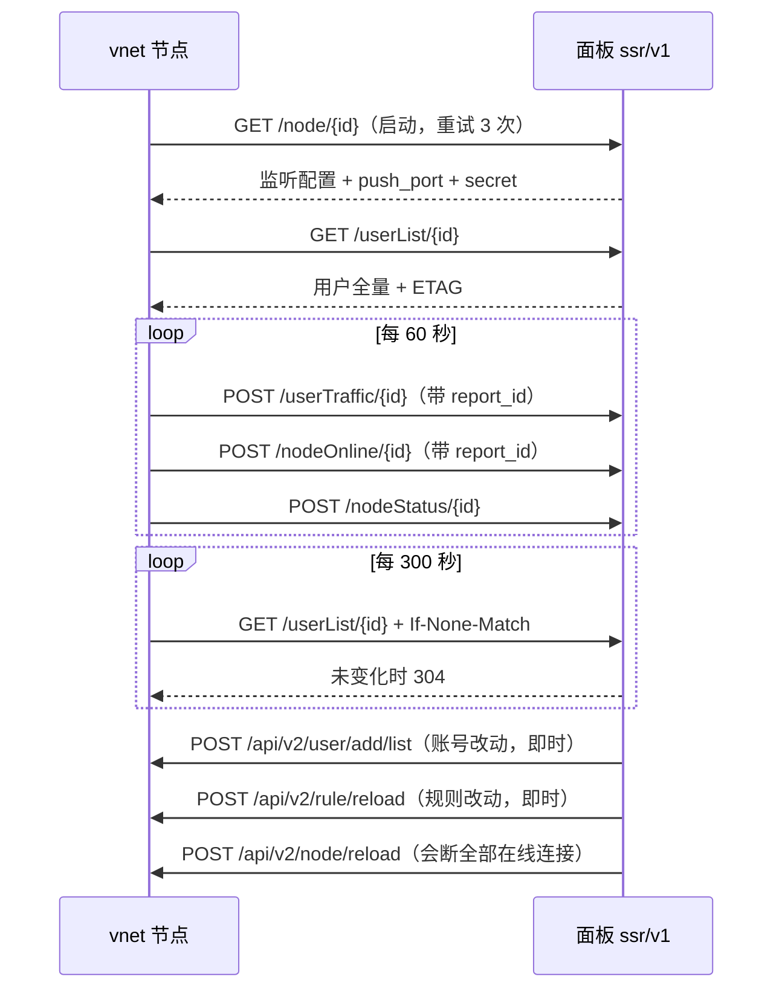

# 面板与本后端的对接

目录：[寻址与鉴权](#寻址与鉴权) · [三条同步通道](#三条同步通道) · [幂等与失败判据](#幂等与失败判据) · [上报的重复窗口](#上报的重复窗口) · [字段之外的约定](#字段之外的约定)

除字段级契约（[openapi.yaml](openapi.yaml)）与算法名单（[capabilities.json](capabilities.json)）之外，对接要弄清楚的是：地址怎么定、什么时候同步、失败之后怎么办。

## 寻址与鉴权

**节点 → 面板**：基址 = 配置的 `api_host` 去掉尾斜杠再加 `/api/ssr/v1`。每个请求带两个头：`key`（节点授权 key）与 `timestamp`（unix 秒），时效窗口 300 秒——两侧时钟不对齐，所有请求都会被判过期。`api_host` 为空或不以 `http://`、`https://` 开头时进程直接退出，不带着坏配置跑。

**面板 → 节点**：`http://{地址}:{push_port}`，每个请求带 `secret` 头。节点只监听这个端口，用哪个地址来推由对端决定（域名或 IPv4 皆可，逐地址问的是同一个进程）。

`secret` 为空时节点拒绝启动 push 服务，重载路径也回错误并保持原配置：空凭据下不带 `secret` 头的请求会与期望值相等，等于把「改用户表、重载整节点」开放给任何能连上该端口的人。

**传输参数**：单请求超时 5 秒，最多跟 2 次重定向，拉取失败退避 5 秒重试 3 次。304 不算失败，也不重投。

## 三条同步通道

| 通道 | 触发 | 频率 | 作用 |
| --- | --- | --- | --- |
| 全量拉取 | 节点启动、`api/v2/node/reload` | 事件驱动 | 用户集合 + 节点配置 + 审计规则 |
| 增量推送 | 面板侧账号与规则的写入点 | 即时 | 账号增删改、节点配置变更、规则重拉 |
| 双向对账 | 面板侧的对账任务，节点自身的周期同步 | 节点每 5 分钟；面板侧周期由面板决定 | 只增删用户，不 reload，不断在线连接 |

推送是加速器，一致性由对账兜住：推送丢一次（节点重启、队列积压、网络抖动）会让已禁用或到期的账号留在节点上，最长 5 分钟后被收敛。审计规则没有周期轮询，规则拉取失败时节点保留旧规则集。

## 幂等与失败判据

`api/v2/user/add/list` 按 uid 落目标状态，而不是「增/删两种动词」：`enable=0` 摘号，内容一致不动，有差异才重建。同一批重复推送不会多出一份，因此面板可以安全重投——传输层没送达就抛异常让队列重试，节点明确回绝只记日志。单账号删除另有一条 `api/user/del/{uid}`。

`api/v2/node/reload` 会断掉全部在线连接，面板不自动重投。本后端先拉用户列表再改配置，拉不到就保留当前服务并回错误，不会把已经在跑的端口打空。

## 上报的重复窗口

流量与在线快照在发送前清账，没送达的整批原样留在待发队列下一轮重发，所以那一分钟的字节在面板只有一份记录。每批流量、每批在线各带一个 `report_id`，格式是 `{node_id}-{启动时刻}-{批次序号}`：同一批内各行相同，重发不变，新批次换新值。面板按 `(node_id, report_id)` 整批认领就闭环，不必按 uid 逐个认领。

流量按行有一个起报门槛：单行增量不足 50 KiB 时先不上报，字节留在节点继续累加，但滞留满 10 分钟就必须上报。所以面板收到的 `upload`/`download` 可能是跨几分钟的累计量；低流量账号的账因此会滞后，但不会少。

面板对「这一批没账可记」（空批、整批 uid 已删）必须回成功：回失败时节点会一直重投同一批、不再取新快照，该节点的账就冻在最后一次成功值上。

审计命中（`trigger`）的重投队列只在载荷永远不会被接受时丢那一条，判据是响应体业务码 400200，不是 HTTP 状态：HTTP 400 也可能是面板写库失败，那种留着重投才救得回来，否则一次库抖动就少一条审计记录。除 400200 之外的一切失败都按可重投处理。流量与在线两批不按这条办理，丢批次等于丢账。

节点侧对审计命中先去重：同一 `(目标, 会话身份)` 在 5 分钟内只报一次，持续撞墙等于一次上报。待发队列每 10 秒投一轮，积压上限 1024 条。

## 字段之外的约定

- 「拉不到集合」与「集合为空」是两回事：`GET /api/user/list` 返回 `[]` 是「节点上没人」，鉴权失败、非 2xx、传输异常是另一种情况。把前者当成后者会让整节点用户被当成缺漏重推。
- `speed_limit` 必须是整数的字节/秒。它是 `uint64`，带小数（如 `12.5`）会让整条请求绑定失败而被拒。
- 审计规则里 `type = protocol` 本后端不实现，静默忽略；生效的是 `reg`、`domain`、`ip`。
- `client_limit` 只在带连接跟踪的协议下生效：`auth_sha1_v4`、`auth_aes128_md5`、`auth_aes128_sha1`、`auth_chain_a` 到 `auth_chain_f`。它是每个桶的上限，不是全节点上限。
- 流量归属：多端口模式按本地监听端口反查 uid，单端口模式按鉴权包里的 uid，与客户端从哪个地址进来无关。端口查不到账号的那部分字节（uid 为 0）直接丢弃，面板不会收。
